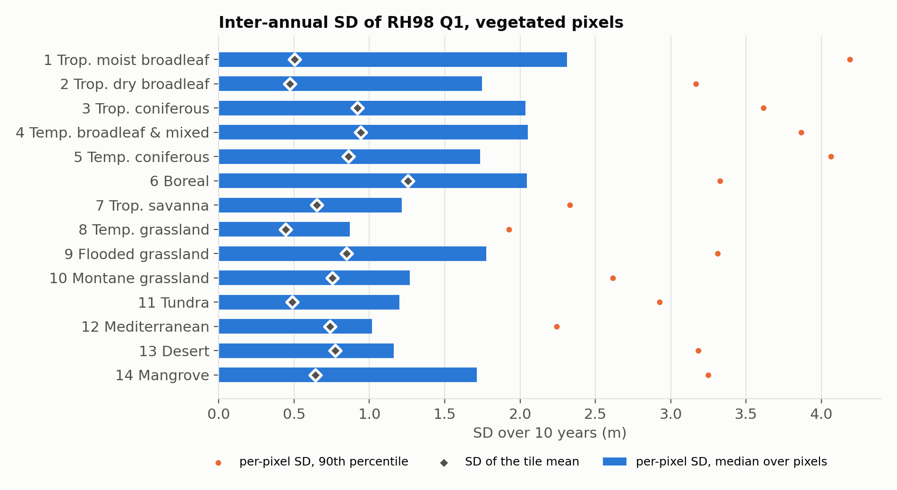
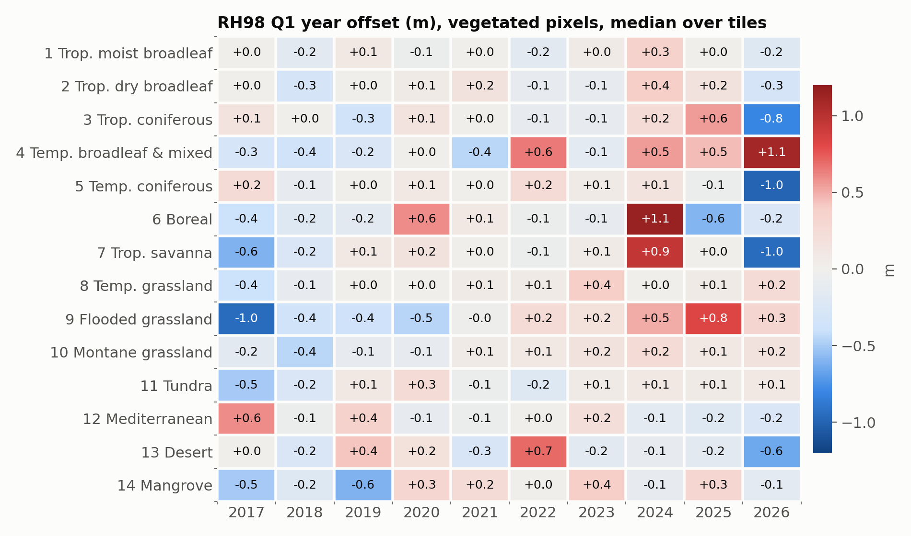
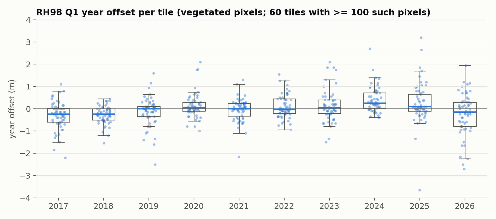
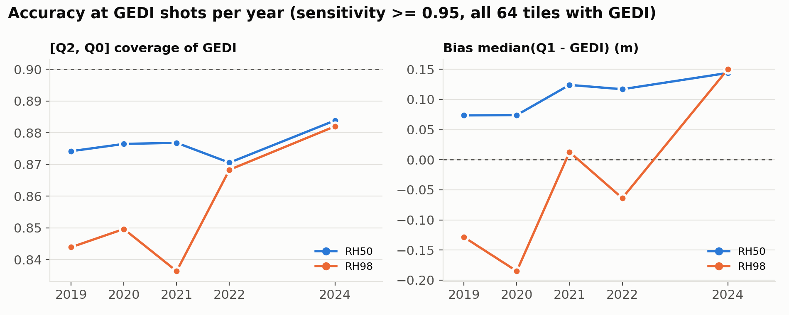

# Inter-annual stability of the VSM yearly prediction, 2017–2026

*2026-10-26. Test run before the full 2024 re-prediction.*

## Summary

We predicted 69 Sentinel-2 tiles (5 per WWF biome) for every year from 2017 to 2026 with the current deploy code. We then read the yearly Q1 at the same 20 000 pixels per tile.

- **Per-pixel noise dominates.** For vegetated pixels, the inter-annual SD of RH98 has a median of 1.7 m (biome medians 0.9–2.3 m). For RH50 it is 0.5 m.
- **Year-level systematic offsets are small but not zero.** The median tile offset of RH98 lies within ±0.25 m in every year. 2024 deviates most: median +0.25 m, with 29 % of tiles above +0.5 m. It is biome-dependent: Boreal +1.1 m, tropical savanna +0.9 m, temperate broadleaf +0.55 m.
- **GEDI points to the same 2024 deviation.** In 2024 the prediction is higher relative to GEDI than in 2019–2022. RH98 bias −0.19 to +0.01 m in 2019–2022, +0.15 m in 2024; 9 of 13 biomes are higher.
- **2026 is an incomplete year.** Its offsets are the most dispersed (18 % of tiles beyond ±1 m), because images were only available up to 2026-10-26.

## Data and methods

**Tiles.** We kept the 39 tiles of the 2024 test (3 per biome; CP cal/test tiles with ≥ 500 GEDI shots, seed 42). We added tiles from the same pool up to 5 per biome; mangrove has only 4 eligible tiles. For Tundra (no CP tiles) we drew 5 tiles from the S2 grid whose land is ≥ 80 % Tundra by WWF area share. In total there are 69 tiles and 14 biomes.

**Pixels.** We drew 20 000 random locations per tile, uniformly over the tile footprint, and fixed them for all years. Statistics use only the pixels whose own WWF biome equals the tile's biome, excluding sea and neighbouring biomes (median 15 000 pixels per tile). *Vegetated* pixels have a multi-year median RH98 ≥ 5 m (median 5 800 per tile; 60 tiles have ≥ 100).

**Predictions.**

| Years | Source |
|---|---|
| 2017–2019, 2021–2026 | Re-predicted on LUMI with the current code. Yearly median of up to 20 growing-season images. No per-tile shift, no blending. |
| 2020 | Released product (`released_v0`), not re-predicted. |

The prediction was kept only at the sample points (no GeoTIFF). On one tile-year (18NZF 2017) these values are identical to values read from the GeoTIFF, in all 18 bands. All 620 tile-years were predicted; 2026 50JLT failed twice (an image without projection metadata) and is missing.

**Metrics** (Q1, per tile, RH ∈ {10, 25, 50, 75, 90, 98}; pixels valid in every year):

| Metric | Definition |
|---|---|
| Inter-annual SD | SD over the 10 years per pixel; we report the median and 90th percentile over pixels, and the SD of the tile mean. |
| Year offset | Median over pixels of (Q1 of the year − the pixel's median over years). This is a systematic shift of one year relative to the others, robust to disturbance in a single year. |
| GEDI accuracy (2019–2022, 2024) | Up to 5 000 shots per tile-year with sensitivity ≥ 0.95. Coverage of [Q2, Q0], bias = median(Q1 − GEDI), MAE. |

## Results

### Per-pixel inter-annual variability

*Figure 1. Inter-annual SD of RH98 Q1 for vegetated pixels.*

- **RH98:** median per-pixel SD 1.7 m. Biome medians range from 0.9 m (temperate grassland) to 2.3 m (tropical moist broadleaf); the 90th percentile is 1.9–4.2 m.
- **Lower RHs:** RH50 0.5 m, RH25 0.2 m.
- **Tile means** are about half as variable: RH98 0.8 m, RH50 0.3 m.

Most of the instability is therefore pixel-level noise that averages out within a tile.

### Systematic year offsets

*Figure 2. RH98 year offset for vegetated pixels (median over the tiles of each biome).*

*Figure 3. RH98 year offset per tile.*

- **Median over tiles:** within ±0.25 m in all years. RH50 is within ±0.05 m.
- **Slight low and high years:**
  - 2017–2018 are slightly low (−0.25 m). In 2017 the image pool is much smaller and cloudier (see [Image availability](#image-availability)); 2018 has a normal pool, so growth may also contribute;
  - 2024–2025 are slightly high (+0.25 m and +0.10 m).
- **2024 is the most biased complete year:** 29 % of tiles exceed +0.5 m (2017–2023: 0–17 %). The shift concentrates in Boreal (+1.1 m), tropical savanna (+0.9 m), temperate broadleaf (+0.55 m) and tropical dry broadleaf (+0.4 m). Flooded grassland is also high (+0.5 m, 4 tiles); temperate grassland, Mediterranean, desert and mangrove stay within ±0.15 m.
- **Isolated large biome-year values** (|offset| ≥ 0.6 m) also occur in other years, for example temperate broadleaf 2022 +0.65 m and desert 2022 +0.7 m. Each rests on 3–5 tiles.
- **2026 is incomplete** (images up to 2026-10-26; Southern-Hemisphere growing seasons not finished). It shows the widest spread and large negative values (temperate coniferous −1.0 m, savanna −0.95 m). It should not be used as a full year.

### Image availability

We repeated the deploy's image selection for every tile-year through STAC: growing-season months, scene cloud cover < 90 %, up to 20 images, full-coverage orbits and low cloud cover first.

| | 2017 | 2018–2025 |
|---|---|---|
| Candidate images per tile (median) | 28 | 58–104 |
| Tiles with < 20 images | 13 of 69 | 0 |
| Scene cloud cover of the selected images (median) | 23 % | 3–8 % |

- **2017 has the poorest inputs**, as Sentinel-2B only entered operations in mid-2017. Few clear observations per pixel produce isolated outliers: in tile 49UDT, 1 % of vegetated pixels are more than 3 m higher in 2017 than in every year 2018–2025, without any forest loss or burn recorded there.
- **Scene cloud cover hardly explains the year offsets.** Across tile-years the Spearman correlation is −0.11 (median offset −0.15 m above 30 % cloud, 0.00 m below 5 %); without 2017 it is −0.02.
- **2024 has ordinary inputs:** median 58 candidates and 7.5 % cloud, Sentinel-2A/B only, and processing baselines 05.10/05.11, which 2022–2023 and 2025 also use with offsets near zero. None of these singles out 2024.
- **Acquisition dates do not single out 2024 either.** The mean acquisition date of a tile-year lies a median 8 days from the tile's usual date in 2024, the smallest shift of all years (8–19 days). The shift hardly relates to the offset (Spearman 0.16), nor does the Sentinel-2B share (0.06).
- **Duplicate products in 2022–2023.** The selection keeps both the original and the reprocessed product of an acquisition, since their ids differ in the processing time. In 2022–2023 this gives 5–7 duplicates among the 20 images of a tile, against 0.1–0.4 in the other years. The median then weights these acquisitions twice; the offsets of 2022–2023 are nevertheless near zero.

### Residual clouds

The deploy masks clouds per pixel with the Sentinel-2 scene classification (SCL). We compared this mask with Cloud Score+ (`cs_cdf`, clear ≥ 0.6) of the same images at the sample pixels, for all 690 tile-years (medians over tiles, vegetated pixels).

| | 2017 | 2018–2021 | 2022–2023 | 2024 | 2025–2026 |
|---|---|---|---|---|---|
| Observations per pixel that SCL keeps | 10.5 | 15.5–16.5 | 17–18 | 15.5 | 15–16.5 |
| Residual cloud: kept by SCL, cloudy for Cloud Score+ | 10.0 % | 5.9–6.9 % | 1.5–1.6 % | 2.5 % | 2.2–2.4 % |
| Removed by SCL, clear for Cloud Score+ | 21 % | 27–40 % | 40–43 % | 39 % | 36–38 % |

- **SCL lets through more cloud before 2022.** Residual cloud falls from 6–10 % to 1.5–2.5 % with processing baseline 04.00 (January 2022), in 82 % of the tiles and in every biome.
- **Residual cloud does not explain the 2024 offset.** 2024 is among the cleanest years, and across tile-years the offset hardly correlates with residual cloud (Spearman −0.1).
- **Pixels with residual cloud are slightly noisier:** median |deviation| 1.04 m without residual cloud, 1.15–1.22 m when more than a quarter of their observations are cloudy (not controlled for biome).
- **SCL also removes many clear observations** (21–43 %). A mask combining SCL and Cloud Score+ could add observations and reduce per-pixel noise.

### Reflectance of the inputs

We read the 12 bands of every selected image at the sample pixels (80 m COG overviews, harmonized as in the deploy). Band year offsets are defined as for RH98: per pixel, the median over the clear observations of the year (SCL and Cloud Score+) minus the pixel's median over years; then the median over the vegetated pixels. Reflectance is in units of 10⁻⁴.

| Biomes 1–7, 9 (median over tiles) | 2017–2021 | 2022–2023 | 2024 | 2025 |
|---|---|---|---|---|
| Red (B04) | +1 to +9 | 0 to +1 | −12 | −13 |
| SWIR2 (B12) | 0 to +4 | +1 to +3 | −12 | −21 |
| NDVI | −0.004 to +0.000 | −0.001 to 0.000 | +0.006 | +0.007 |
| RH98 offset (m) | −0.3 to +0.1 | −0.1 to 0.0 | +0.4 | +0.1 |

- **Height offsets follow greenness, in every year.** Across tile-years, darker visible and SWIR bands and higher NDVI go with a higher RH98 (Spearman −0.4 to −0.55 for B02–B05, B11 and B12; +0.45 for NDVI; NIR ≈ 0). A regression fitted on the other years predicts the tile offsets of a left-out year with r = 0.4–0.66 (2024: 0.63).
- **2024 is greener in the forest and savanna biomes.** The strongest tile, 49UFS (Boreal, +2.7 m), has NDVI +0.18 and red −0.014.
- **Greenness explains only about a third of 2024.** Fitted on the other years, the regression predicts +0.09 m for 2024 against +0.25 m observed. The residual of +0.16 to +0.27 m (depending on bands and mask) is the largest of all years. 2025 is as green as 2024 but its offset is only +0.1 m.
- **No sign of a sensor effect.** The S2A − S2B difference in 2024 is within the range of the other years, and the sun zenith angle hardly relates to the offset (Spearman 0.11).
- **Limits of this check:** these are yearly medians of 80 m reflectance, while the prediction is the median of per-image predictions at 10 m. Differences between single images, or in fine spatial texture, are not captured.

### Agreement with GEDI

*Figure 4. [Q2, Q0] coverage and bias at GEDI shots per year (64 tiles with GEDI).*

- **RH98 coverage:** 0.84–0.87 in 2019–2022 and 0.88 in 2024, against a nominal 0.90.
- **RH98 bias:** rises from −0.19 to +0.01 m (2019–2022) to +0.15 m in 2024. Per biome, the 2024 bias exceeds the 2019–2022 mean in 9 of 13 biomes, by up to +0.9 m (tropical coniferous, savanna).
- **Interpretation:** the GEDI shots differ every year, and 2024 GEDI data follow the 2023–2024 instrument hibernation, so this comparison alone is not conclusive. Its agreement with the GEDI-independent year offsets suggests that 2024 inputs yield slightly higher predictions in forest and savanna biomes.

## Implications for the 2024 re-prediction

1. **The current pipeline is reproducible and stable at tile level.** Re-predicting 2024 without the per-tile shift is justified: residual year effects are ≤ 0.25 m at the median, against ~1–4 m for the old per-tile shifts.
2. **The 2024 forest/savanna offset of up to ~1 m comes from the 2024 inputs, not from the old run.** Image count, acquisition dates, cloud cover, residual cloud, platform and processing baseline do not single out 2024 (see [Image availability](#image-availability) and [Residual clouds](#residual-clouds)). About a third of it follows the greener 2024 reflectance, to which the model responds in every year (see [Reflectance of the inputs](#reflectance-of-the-inputs)); the rest is not explained by the yearly median reflectance. Per-image predictions on the strongest tiles (e.g. 49UFS, 33PZL, 19TFN, 2023–2025) would show whether all 2024 images predict high or only some.
3. **Conformal calibration should be fitted per year** (as planned), since bias and coverage shift between years by up to ~0.9 m per biome.
4. **2026 should be re-run after the season is complete** if it is to be released.

## Limitations

- Each biome is represented by 3–5 tiles; biome-year values are indicative only.
- The 2020 values come from the released product, not from the current code. Its offsets are small (|offset| ≤ 0.6 m), so the release and the current code appear consistent.
- Year offsets cannot separate real change (growth, disturbance) from input-driven shifts. The median over pixels limits the effect of local disturbance but not of biome-wide trends.

## Reproduction

| Step | Code |
|---|---|
| Tool | `tools/vsm_stability.py` (`select_stability_tiles`, `make_stability_pixels`, `write_stability_points`, `sample_stability_tile`, `summarize_stability_years`); configuration in `config/tools/config.yaml`. |
| Predict | `scripts/lumi/run_lumi_inference.sh predict_sample_worklist` |
| Images | `python -m tools.run run=count_stability_images` → `stability_images.tsv` |
| Clouds | `run=sample_stability_scl`, `run=sample_stability_cloudscore`, `run=summarize_stability_clouds` → `stability_clouds_{tiles,bins}.tsv` |
| Reflectance | `run=sample_stability_reflectance`, `run=summarize_stability_reflectance` → `stability_reflectance_tiles.tsv` |
| Figures | `tools/vsm_stability_plots.py`: `run=plot_stability_report` (fig1–4), `run=plot_stability_inputs` (fig5–6), `run=plot_stability_schematic` (fig0) |

Data (LUMI, `/scratch/project_465003168/hui/gvs`):

| Data | Path |
|---|---|
| Points and sampled values | `vsm_stability/2017_2026/{sample_pixels,point_samples,pixel_values,gedi_values}` |
| Inputs at the points | `vsm_stability/2017_2026/{scl_values,cloudscore_values,reflectance_values}` |
| Tables and state | `vsm_stability_state/2017_2026/` |
