# Inter-annual stability of the VSM yearly prediction, 2017–2026

*2026-10-26. Test run before the full 2024 re-prediction. Updated 2026-11-09: [What is different about the 2024 inputs](#what-is-different-about-the-2024-inputs); 2026-11-10: [Wider test on 60 tiles](#wider-test-on-60-tiles).*

## Summary

We predicted 69 Sentinel-2 tiles (5 per WWF biome) for every year from 2017 to 2026 with the current deploy code. We then read the yearly Q1 at the same 20 000 pixels per tile.

- **Per-pixel noise dominates.** For vegetated pixels, the inter-annual SD of RH98 has a median of 1.7 m (biome medians 0.9–2.3 m). For RH50 it is 0.5 m.
- **Year-level systematic offsets are small but not zero.** The median tile offset of RH98 lies within ±0.25 m in every year. 2024 deviates most: median +0.25 m, with 29 % of tiles above +0.5 m. It is biome-dependent: Boreal +1.1 m, tropical savanna +0.9 m, temperate broadleaf +0.55 m.
- **The 2024 deviation comes from the 2024 inputs.** Image count, dates, clouds, platform and processing baseline are ordinary. About a third follows the greener 2024 reflectance. Single-image predictions on the five strongest tiles are higher than the other years at the same time of the season (+0.8 to +1.6 m on four of them), over most of the season rather than in a few outlier images. Of 8 control tiles (2024 year offset near 0) only Boreal 20ULC shows the same rise.
- **2024 was an anomalous growing season on these tiles, not an S2 artefact.** Water and the darkest pixels show no radiometric shift. The vegetation of the strong tiles is darker in SWIR2 and mostly brighter in NIR. MODIS sees the same: 2024 is the greenest year of 2018–2025 on 49UFS, 49UDT and 33PZL. ERA5-Land shows a warm (+0.9 to +1.1 K on the Boreal tiles) and rather dry growing season. Band offsets of single images predict most of their 2024 RH98 offset.
- **On 60 more tiles chosen by the 2024 MODIS anomaly, 2024 is higher on most tiles, but greening explains little of it.** RH98 2024 minus the mean of 2023 and 2025: median +0.30 m, 40 of 60 tiles above 0. Tiles whose MODIS NDVI did not change rise as much (+0.47 m) as greener ones (+0.33 m); browner ones stay at −0.03 m. All 10 Boreal tiles rise, 8 of them by 0.7 m or more. The cause of the general part of the rise is not identified.
- **GEDI points to the same 2024 deviation.** In 2024 the prediction is higher relative to GEDI than in 2019–2022. RH98 bias −0.19 to +0.01 m in 2019–2022, +0.15 m in 2024; 9 of 13 biomes are higher.
- **2026 is an incomplete year.** Its offsets are the most dispersed (18 % of tiles beyond ±1 m), because images were only available up to 2026-10-26.

## Data and methods

**Tiles.** We kept the 39 tiles of the 2024 test (3 per biome; CP cal/test tiles with ≥ 500 GEDI shots, seed 42). We added tiles from the same pool up to 5 per biome; mangrove has only 4 eligible tiles. For Tundra (no CP tiles) we drew 5 tiles from the S2 grid whose land is ≥ 80 % Tundra by WWF area share. In total there are 69 tiles and 14 biomes.

**Pixels.** We drew 20 000 random locations per tile, uniformly over the tile footprint, and fixed them for all years. Statistics use only the pixels whose own WWF biome equals the tile's biome, excluding sea and neighbouring biomes (median 15 000 pixels per tile). *Vegetated* pixels have a multi-year median RH98 ≥ 5 m (median 5 800 per tile; 60 tiles have ≥ 100).

**Predictions.**

| Years | Source |
|---|---|
| 2017–2019, 2021–2026 | Re-predicted on LUMI with the current code. Yearly median of up to 20 growing-season images. No per-tile shift, no blending. |
| 2020 | Released product (`released_v0`), not re-predicted. |

The prediction was kept only at the sample points (no GeoTIFF). On one tile-year (18NZF 2017) these values are identical to values read from the GeoTIFF, in all 18 bands. All 620 tile-years were predicted; 2026 50JLT failed twice (an image without projection metadata) and is missing.

**Metrics** (Q1, per tile, RH ∈ {10, 25, 50, 75, 90, 98}; pixels valid in every year):

| Metric | Definition |
|---|---|
| Inter-annual SD | SD over the 10 years per pixel; we report the median and 90th percentile over pixels, and the SD of the tile mean. |
| Year offset | Median over pixels of (Q1 of the year − the pixel's median over years). This is a systematic shift of one year relative to the others, robust to disturbance in a single year. |
| GEDI accuracy (2019–2022, 2024) | Up to 5 000 shots per tile-year with sensitivity ≥ 0.95. Coverage of [Q2, Q0], bias = median(Q1 − GEDI), MAE. |

## Results

### Per-pixel inter-annual variability

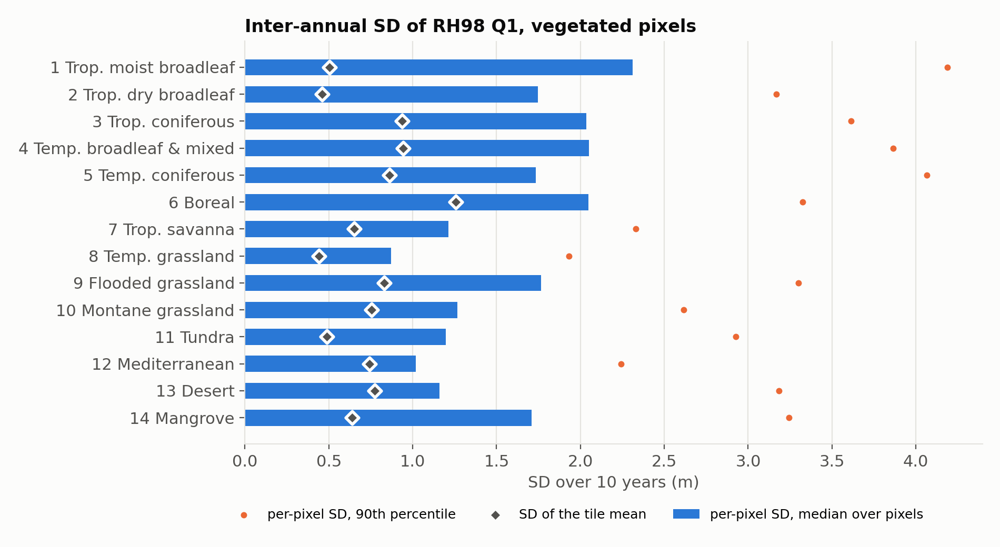

*Figure 1. Inter-annual SD of RH98 Q1 for vegetated pixels.*

- **RH98:** median per-pixel SD 1.7 m. Biome medians range from 0.9 m (temperate grassland) to 2.3 m (tropical moist broadleaf); the 90th percentile is 1.9–4.2 m.
- **Lower RHs:** RH50 0.5 m, RH25 0.2 m.
- **Tile means** are about half as variable: RH98 0.8 m, RH50 0.3 m.

Most of the instability is therefore pixel-level noise that averages out within a tile.

### Systematic year offsets

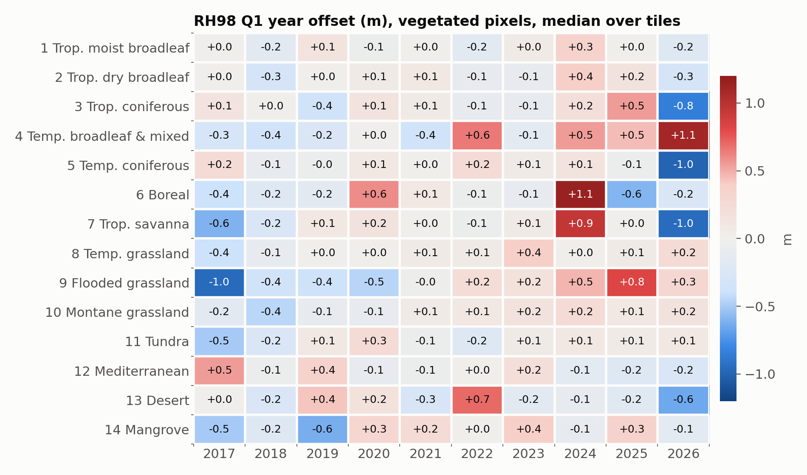

*Figure 2. RH98 year offset for vegetated pixels (median over the tiles of each biome).*

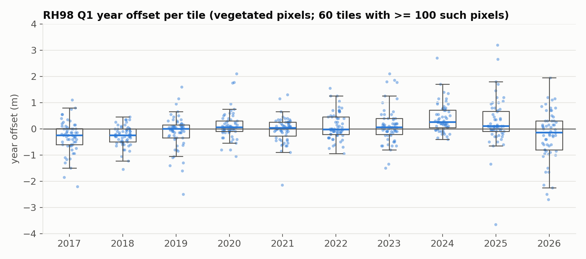

*Figure 3. RH98 year offset per tile.*

- **Median over tiles:** within ±0.25 m in all years. RH50 is within ±0.05 m.
- **Slight low and high years:**
  - 2017–2018 are slightly low (−0.25 m). In 2017 the image pool is much smaller and cloudier (see [Image availability](#image-availability)); 2018 has a normal pool, so growth may also contribute;
  - 2024–2025 are slightly high (+0.25 m and +0.10 m).
- **2024 is the most biased complete year:** 29 % of tiles exceed +0.5 m (2017–2023: 0–17 %). The shift concentrates in Boreal (+1.1 m), tropical savanna (+0.9 m), temperate broadleaf (+0.55 m) and tropical dry broadleaf (+0.4 m). Flooded grassland is also high (+0.5 m, 4 tiles); temperate grassland, Mediterranean, desert and mangrove stay within ±0.15 m.
- **Isolated large biome-year values** (|offset| ≥ 0.6 m) also occur in other years, for example temperate broadleaf 2022 +0.65 m and desert 2022 +0.7 m. Each rests on 3–5 tiles.
- **2026 is incomplete** (images up to 2026-10-26; Southern-Hemisphere growing seasons not finished). It shows the widest spread and large negative values (temperate coniferous −1.0 m, savanna −0.95 m). It should not be used as a full year.

### Image availability

We repeated the deploy's image selection for every tile-year through STAC: growing-season months, scene cloud cover < 90 %, up to 20 images, full-coverage orbits and low cloud cover first.

| | 2017 | 2018–2025 |
|---|---|---|
| Candidate images per tile (median) | 28 | 58–104 |
| Tiles with < 20 images | 13 of 69 | 0 |
| Scene cloud cover of the selected images (median) | 23 % | 3–8 % |

- **2017 has the poorest inputs**, as Sentinel-2B only entered operations in mid-2017. Few clear observations per pixel produce isolated outliers: in tile 49UDT, 1 % of vegetated pixels are more than 3 m higher in 2017 than in every year 2018–2025, without any forest loss or burn recorded there.
- **Scene cloud cover hardly explains the year offsets.** Across tile-years the Spearman correlation is −0.11 (median offset −0.15 m above 30 % cloud, 0.00 m below 5 %); without 2017 it is −0.02.
- **2024 has ordinary inputs:** median 58 candidates and 7.5 % cloud, Sentinel-2A/B only, and processing baselines 05.10/05.11, which 2022–2023 and 2025 also use with offsets near zero. None of these singles out 2024.
- **Acquisition dates do not single out 2024 either.** The mean acquisition date of a tile-year lies a median 8 days from the tile's usual date in 2024, the smallest shift of all years (8–19 days). The shift hardly relates to the offset (Spearman 0.16), nor does the Sentinel-2B share (0.06).
- **Duplicate products in 2022–2023.** The selection keeps both the original and the reprocessed product of an acquisition, since their ids differ in the processing time. In 2022–2023 this gives 5–7 duplicates among the 20 images of a tile, against 0.1–0.4 in the other years. The median then weights these acquisitions twice; the offsets of 2022–2023 are nevertheless near zero.

### Residual clouds

The deploy masks clouds per pixel with the Sentinel-2 scene classification (SCL). We compared this mask with Cloud Score+ (`cs_cdf`, clear ≥ 0.6) of the same images at the sample pixels, for all 690 tile-years (medians over tiles, vegetated pixels).

| | 2017 | 2018–2021 | 2022–2023 | 2024 | 2025–2026 |
|---|---|---|---|---|---|
| Observations per pixel that SCL keeps | 10.5 | 15.5–16.5 | 17–18 | 15.5 | 15–16.5 |
| Residual cloud: kept by SCL, cloudy for Cloud Score+ | 10.0 % | 5.9–6.9 % | 1.5–1.6 % | 2.5 % | 2.2–2.4 % |
| Removed by SCL, clear for Cloud Score+ | 21 % | 27–40 % | 40–43 % | 39 % | 36–38 % |

- **SCL lets through more cloud before 2022.** Residual cloud falls from 6–10 % to 1.5–2.5 % with processing baseline 04.00 (January 2022), in 82 % of the tiles and in every biome.
- **Residual cloud does not explain the 2024 offset.** 2024 is among the cleanest years, and across tile-years the offset hardly correlates with residual cloud (Spearman −0.1).
- **Pixels with residual cloud are slightly noisier:** median |deviation| 1.04 m without residual cloud, 1.15–1.22 m when more than a quarter of their observations are cloudy (not controlled for biome).
- **SCL also removes many clear observations** (21–43 %). A mask combining SCL and Cloud Score+ could add observations and reduce per-pixel noise.

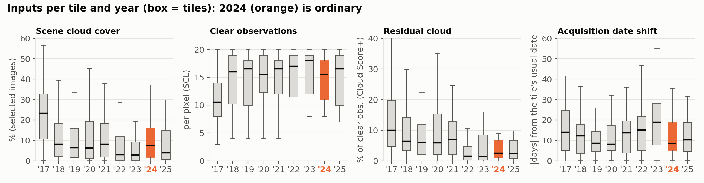

*Figure 4. Inputs per tile-year (box = tiles, 2017–2025; 2024 in orange): scene cloud cover of the selected images, clear observations per pixel (SCL), residual cloud (kept by SCL, cloudy for Cloud Score+), and the shift of the mean acquisition date from the tile's usual date.*

### Reflectance of the inputs

We read the 12 bands of every selected image at the sample pixels (80 m COG overviews, harmonized as in the deploy). Band year offsets are defined as for RH98: per pixel, the median over the clear observations of the year (SCL and Cloud Score+) minus the pixel's median over years; then the median over the vegetated pixels. Reflectance is in units of 10⁻⁴.

| Biomes 1–7, 9 (median over tiles) | 2017–2021 | 2022–2023 | 2024 | 2025 |
|---|---|---|---|---|
| Red (B04) | 0 to +9 | 0 to +1 | −12 | −13 |
| SWIR2 (B12) | 0 to +4 | +1 to +5 | −12 | −21 |
| NDVI | −0.004 to +0.000 | −0.001 to 0.000 | +0.006 | +0.007 |
| RH98 offset (m) | −0.3 to +0.1 | −0.1 to 0.0 | +0.4 | +0.1 |

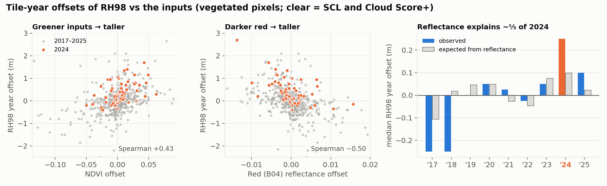

*Figure 5. Tile-year offsets of RH98 against the NDVI and red offsets (2024 in orange), and the median RH98 offset per year, observed and expected from a regression on the band offsets fitted on the other years.*

- **Height offsets follow greenness, in every year.** Across tile-years, darker visible and SWIR bands and higher NDVI go with a higher RH98 (Spearman −0.4 to −0.55 for B02–B05, B11 and B12; +0.45 for NDVI; NIR ≈ 0). A regression fitted on the other years predicts the tile offsets of a left-out year with r = 0.4–0.66 (2024: 0.63).
- **2024 is greener in the forest and savanna biomes.** The strongest tile, 49UFS (Boreal, +2.7 m), has NDVI +0.18 and red −0.014.
- **Greenness explains only about a third of 2024.** Fitted on the other years, the regression predicts +0.10 m for 2024 against +0.25 m observed. The residual of +0.15 to +0.27 m (depending on bands and mask) is the largest of all years. 2025 is as green as 2024 but its offset is only +0.1 m.
- **No sign of a sensor effect.** The S2A − S2B difference in 2024 is within the range of the other years, and the sun zenith angle hardly relates to the offset (Spearman 0.11).
- **Limits of this check:** these are yearly medians of 80 m reflectance, while the prediction is the median of per-image predictions at 10 m. Differences between single images, or in fine spatial texture, are not captured.

### Single-image predictions

We re-ran the five tiles with the largest 2024 offsets (49UFS, 19TFN, 49UDT Boreal; 33PZL savanna; 48QYK tropical moist broadleaf) for 2022–2025 and kept the prediction of every image at the sample pixels, 400 images in total. The image offset is the median over vegetated pixels of (image Q1 − the pixel's multi-year median of the yearly Q1). In 19 of the 20 tile-years, the yearly values of this run equal the main run at every pixel (19TFN 2025: see [Limitations](#limitations)).

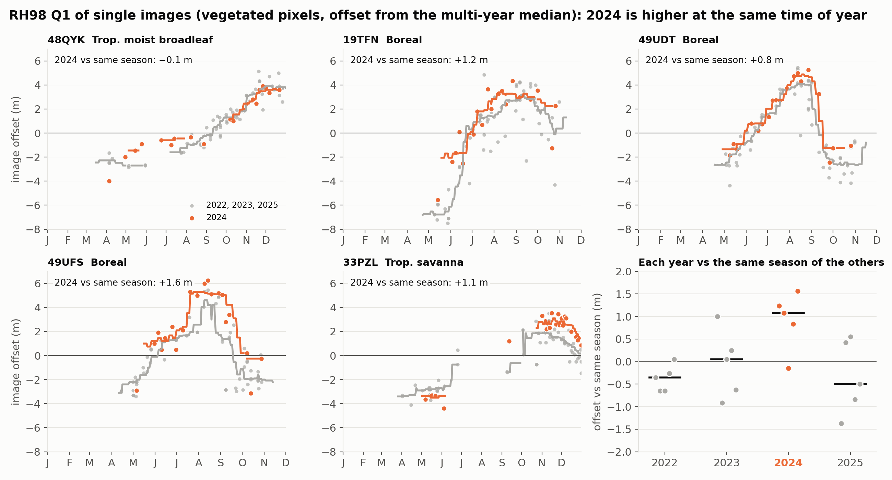

*Figure 6. RH98 Q1 offset of single images over the season, 2024 (orange) against 2022, 2023 and 2025 (grey); lines are ±20-day running medians. Bottom right: per tile-year, the median over its images of the difference to the other years' images within ±20 days.*

- **Single images follow the season strongly.** Image offsets run from −2 to −7 m in spring to +3 to +6 m in mid-summer (Boreal) or in the early dry season (savanna). The yearly median therefore depends on which part of the season the 20 images cover.
- **2024 is higher at the same time of year.** Against the other years' images within ±20 days, the 2024 images are higher by +1.6 m (49UFS), +1.2 m (19TFN), +1.1 m (33PZL) and +0.8 m (49UDT). The other years give −0.4, +0.05 and −0.5 m (median over tiles in 2022, 2023, 2025). Only the tropical tile 48QYK is not higher (−0.1 m).
- **It is not a few outlier images.** On 49UFS, 85 % of the 2024 images lie above zero (2022–2025: 40–50 %). The 2024 curve is higher over most of the season and stays high later into autumn (49UFS in September: +3.4 m, against −2.8 to +1.5 m in the other years), consistent with the greener 2024 reflectance.
- **Season coverage adds to it on some tiles.** On 49UFS, 12 of the 20 images of 2024 fall in June–August, against 4–6 in the other years.

We repeated the single-image run on 8 control tiles whose 2024 year offset is near 0 (18NZF, 13QFC, 14QPD, 16TFS, 12TVK, 53WMM, and the least-shifted Boreal and savanna tiles 20ULC and 37QCU), 2022–2025.

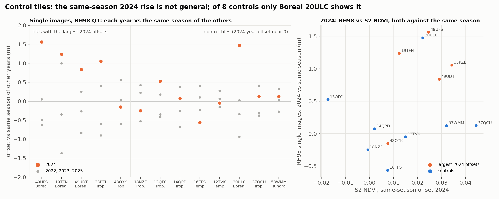

*Figure 6b. Left: per tile, each year's single-image RH98 offset against the same season of the other years (2024 orange). Right: the 2024 value against the same-season S2 NDVI offset of 2024.*

- **The same-season rise is not general.** On the controls 2024 lies at −0.56 to +0.50 m against the same season (median +0.10 m), like the other years (−0.94 to +0.42 m); on the strong tiles it is +0.8 to +1.6 m.
- **One control behaves like the strong tiles:** Boreal 20ULC, +1.5 m at the same season. Its year offset is only +0.45 m because its 2024 images cover a different part of the season. 2024 was greener (S2 NDVI +0.022) and warm (ERA5-Land +1.6 K) there too. All four Boreal tiles tested show the rise.
- **Greenness alone does not predict it.** Sparse savanna 37QCU and Tundra 53WMM are greener in 2024 (S2 NDVI +0.03 to +0.04) without a height rise; 13QFC is browner and +0.5 m.

### What is different about the 2024 inputs

We checked whether the 2024 images of the strong tiles carry a radiometric shift, a real vegetation anomaly, or a disturbance signal. Reflectance offsets of single images are computed like the RH98 image offset: per pixel, the image value minus the pixel's median over the clear observations (SCL and Cloud Score+) of all years, then the median over vegetated pixels. Water pixels (SCL 6) and the darkest 2 % of clear pixels serve as dark targets that greening does not change. Year values are the median over a tile-year's images of the difference to the other years' images within ±20 days.

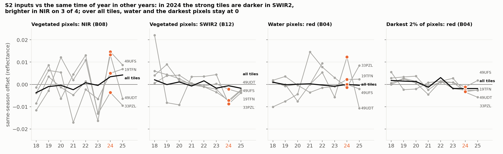

*Figure 7. Same-season offset of the S2 inputs per year: vegetated NIR and SWIR2, red of water pixels and of the darkest 2 % of pixels. Grey lines: the four strong tiles (2024 in orange); black: median over all tiles.*

- **No radiometric shift in 2024.** Over all tiles, water pixels (red 0.0000) and the darkest pixels (−0.0018, as in 2023 and 2025) do not move. Processing baselines 05.10 and 05.11 give the same NDVI offset (+0.0038), and S2A and S2B differ little.
- **The strong tiles look different in 2024.** Their vegetation is darker in SWIR2 (−0.007 to −0.009 on 49UFS, 49UDT and 33PZL, the lowest of 2018–2025) and brighter in NIR on 49UFS and 49UDT (+0.015, +0.013, the highest). 33PZL is greener through red and SWIR, not NIR.
- **Over all tiles 2024 is only slightly greener.** Forest and savanna biomes: NDVI +0.012 in 2024, against +0.008 in 2023 and 2025 and −0.004 to −0.011 in 2019–2021.

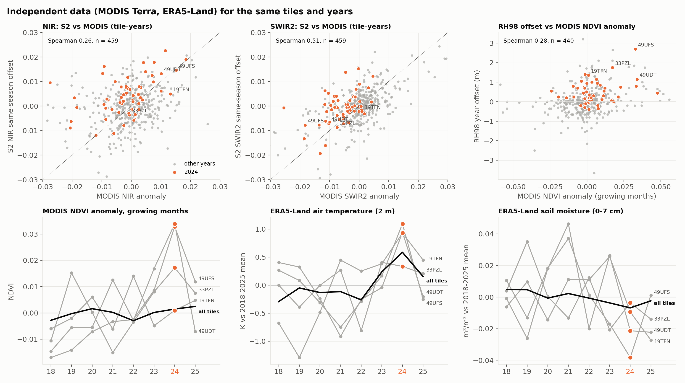

*Figure 8. Top: S2 same-season offsets against MODIS Terra (MOD13Q1, 250 m, 16-day) anomalies per tile-year, and the RH98 year offset against the MODIS NDVI anomaly (2024 in orange). Bottom: MODIS NDVI and ERA5-Land growing-season 2 m temperature and 0–7 cm soil moisture for the strong tiles. MODIS: median over up to 300 vegetated sample pixels, minus the same composite in 2018–2025, median over the growing months. 58 tiles; 11 tiles have fewer than 20 vegetated pixels.*

- **MODIS confirms the anomaly.** 2024 is the greenest year of 2018–2025 in MODIS NDVI on 49UFS (+0.033), 49UDT (+0.034) and 33PZL (+0.017); 19TFN is not (rank 4 of 8). S2 and MODIS agree per tile-year in SWIR2 (Spearman 0.50) and less in NIR (0.26).
- **Greener tile-years are higher.** Across all tile-years the RH98 offset rises with the MODIS NDVI anomaly (Spearman 0.28). In 2024 the 20 tiles above +0.5 m have MODIS NDVI +0.005 and S2 NDVI +0.017; the 21 tiles within ±0.2 m have +0.001 and −0.001.
- **2024 was warm, not wet.** The growing season of the Boreal tiles was the warmest of 2018–2025 (+0.9 to +1.1 K; median over all tiles +0.6 K). 49UFS had 26 % less precipitation and the lowest soil moisture. The darker SWIR2 therefore points to more green leaf cover rather than wetter ground.

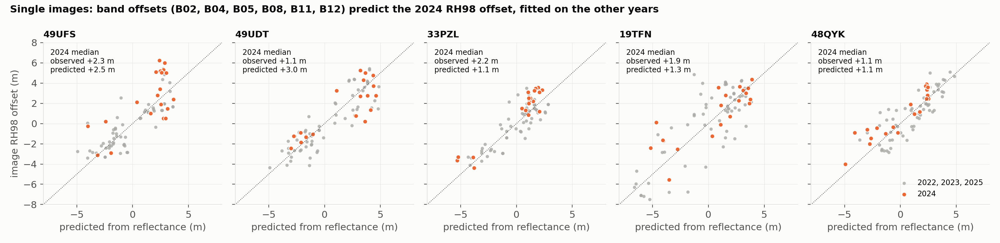

*Figure 9. Single images: RH98 offset against the offset predicted from the band offsets (B02, B04, B05, B08, B11, B12), fitted per tile on the other years (2022, 2023, 2025 leave one year out; 2024 fitted on all three).*

- **Reflectance predicts most of the 2024 offset.** 2024 median observed / predicted: 49UFS +2.3 / +2.5 m, 19TFN +1.9 / +1.3 m, 33PZL +2.2 / +1.1 m, 49UDT +1.1 / +3.0 m. The model translates the 2024 spectra into greater height; the residual is largest on 33PZL.
- **Not disturbance and regrowth.** Pixels that stayed within ±1.5 m of their 2017–2021 median through 2023 show the same 2024 offset as all pixels (+1.0 to +2.7 m). Pixels that dropped by ≥ 3 m in 2022–2023 rise above their pre-drop level in 2024 (49UFS +2.8 m) and fall back in 2025, which regrowth cannot do.
- **2022 and 2023 are not raised.** Against the 2017–2021 median, the strong tiles lie at −0.9 to +0.8 m in 2022–2023 and jump only in 2024 (19TFN is already high in 2023). Over all tiles 2022–2023 are +0.16 m above 2017–2021, in line with the trend of about +0.06 m per year.

### Agreement with GEDI

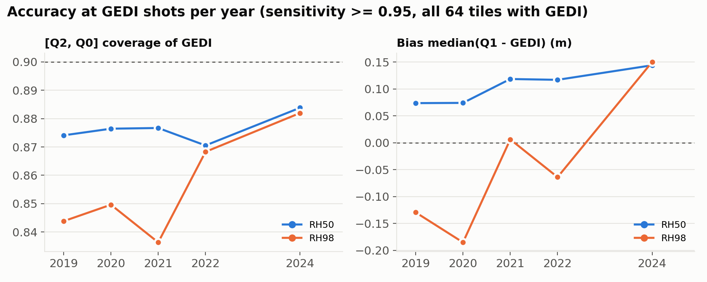

*Figure 10. [Q2, Q0] coverage and bias at GEDI shots per year (64 tiles with GEDI).*

- **RH98 coverage:** 0.84–0.87 in 2019–2022 and 0.88 in 2024, against a nominal 0.90.
- **RH98 bias:** rises from −0.19 to +0.01 m (2019–2022) to +0.15 m in 2024. Per biome, the 2024 bias exceeds the 2019–2022 mean in 9 of 13 biomes, by up to +0.9 m (tropical coniferous, savanna).
- **Interpretation:** the GEDI shots differ every year, and 2024 GEDI data follow the 2023–2024 instrument hibernation, so this comparison alone is not conclusive. Its agreement with the GEDI-independent year offsets suggests that 2024 inputs yield slightly higher predictions in forest and savanna biomes.

### Wider test on 60 tiles

The 13 tiles of the single-image and input checks were partly chosen for their large 2024 offsets. To test on other tiles whether a greener 2024 season gives higher predictions and a browner one lower predictions, we screened all 18 156 land tiles with MODIS MOD13Q1. Per tile, the 2024 NDVI anomaly is the 2024 value minus the mean of 2023 and 2025 in the same months, averaged over ESA WorldCover tree pixels and the growing months (SD across tiles 0.023). Among tiles with at least 40 % tree cover and outside the 69-tile set, we took 20 tiles from each of three groups, spread over the biomes: the greenest 10 % (anomaly ≥ +0.016), the brownest 10 % (≤ −0.017) and the least changed (within ±0.001). We predicted 2023–2025 for each tile at 20 000 fixed pixels and computed the median, over vegetated own-biome pixels, of the RH98 Q1 change: 2024 minus the mean of 2023 and 2025.

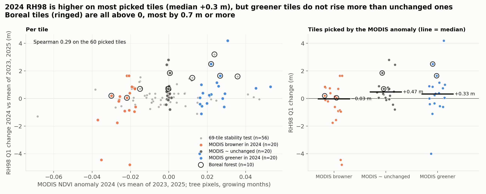

*Figure 11. Left: RH98 Q1 change of 2024 against the MODIS NDVI anomaly of 2024, per tile, for the 60 picked tiles and the 69-tile stability test; Boreal tiles ringed. Right: the 60 picked tiles by group, line = median.*

- **2024 is higher on most tiles, not only on the strong ones.** Median change +0.30 m over the 60 tiles, 40 of them above 0. The 69-tile set gives +0.10 m by the same measure.
- **Greening explains little of it.** Group medians: browner −0.03 m (95 % bootstrap interval −0.88 to +0.55 m), unchanged +0.47 m (+0.12 to +0.70 m), greener +0.33 m (−0.17 to +0.87 m). The groups do not differ significantly (Kruskal–Wallis p = 0.11). The Spearman correlation with the MODIS anomaly is weak, 0.29 (p = 0.03). Tiles with no MODIS NDVI change rise by about 0.5 m, so most of the general rise is not a greening response.
- **Boreal is the exception.** All 10 Boreal tiles (4 from the stability test, 6 new) are above 0, 8 of them by 0.7 m or more (up to +3.2 m). Within Boreal the order follows greenness: greener +1.65 and +2.5 m, unchanged +0.7 and +1.85 m, browner +0.05 and +0.2 m. This matches the warm, green 2024 season found on the Boreal strong tiles.
- **Single tiles are noisy.** Changes range from −4.8 to +4.2 m; the interquartile range within a group is 0.7–1.6 m, larger than the group differences, so 20 tiles per group only resolve a strong effect. The largest drops (20PKR, 44RKU, 37TDK, −4.0 to −4.8 m) were not checked for disturbance.
- **RH50 shows the same pattern, smaller:** group medians −0.03 m (browner), +0.13 m (unchanged), +0.05 m (greener).

## Implications for the 2024 re-prediction

1. **The current pipeline is reproducible and stable at tile level.** Re-predicting 2024 without the per-tile shift is justified: residual year effects are ≤ 0.25 m at the median, against ~1–4 m for the old per-tile shifts.
2. **The 2024 forest/savanna offset of up to ~1 m comes from the 2024 inputs, not from the old run.** The inputs carry a real anomaly of the 2024 growing season (greener in MODIS and S2, warm in ERA5-Land; see [What is different about the 2024 inputs](#what-is-different-about-the-2024-inputs)), which the model turns into greater height. Image count, acquisition dates, cloud cover, residual cloud, platform and processing baseline do not single out 2024 (see [Image availability](#image-availability) and [Residual clouds](#residual-clouds)). About a third of it follows the greener 2024 reflectance, to which the model responds in every year (see [Reflectance of the inputs](#reflectance-of-the-inputs)). Single images of 2024 predict higher than the other years at the same time of the season, over most of the season (see [Single-image predictions](#single-image-predictions)). The offset is thus a season-wide response to the 2024 conditions, not a few faulty images, and cannot be removed by dropping images. On 60 more tiles 2024 is about +0.3 m higher than 2023/2025 in general, and greening explains only a small part of that; only in Boreal forests is the rise large and ordered by greenness (see [Wider test on 60 tiles](#wider-test-on-60-tiles)).
3. **Conformal calibration should be fitted per year** (as planned), since bias and coverage shift between years by up to ~0.9 m per biome.
4. **2026 should be re-run after the season is complete** if it is to be released.

## Limitations

- Each biome is represented by 3–5 tiles; biome-year values are indicative only.
- The 2020 values come from the released product, not from the current code. Its offsets are small (|offset| ≤ 0.6 m), so the release and the current code appear consistent.
- **19TFN 2025 in the main run is wrong.** The re-run with the same 20 images gives a median RH98 of 14.8 m instead of 10.6 m (2023–2024: 16 m), so its offset of −3.65 m (Figure 3) is an artefact of that run; the cause is unknown, as its log was not kept. The other tile-years of the main run were not re-run.
- **The single-image and spectral checks rest on 13 tiles**, 5 of them chosen for the largest 2024 offsets. The [wider test on 60 tiles](#wider-test-on-60-tiles) covers only yearly predictions of 2023–2025, without single images or reflectance, so the cause of its general rise is not known.
- **MODIS Terra drifts in 2024–2025:** its NIR and SWIR2 fall over all tiles (2025: −0.008, −0.009). The strong-tile anomalies of 2024 are larger, and NDVI is less affected, but MODIS NIR/SWIR2 values of 2024–2025 should be read with care. ERA5-Land is a ~9 km mean over the sample area.
- **Harmonization missed reprocessed pre-2022 products.** `harmonize_to_old` (Planetary Computer example) subtracted the 1000 offset by acquisition date only. 33 selected images of 2019 (March) and 2021 (mostly December) are reprocessed products with baseline 04.00/05.00 and kept the offset, i.e. reflectance 0.1 too high; 2020 and 2022 onwards are not affected. Fixed on 2026-11-09 (decided per product by baseline or processing time). The 24 affected tile-years (2019: 6, 2021: 18) were re-predicted and their reflectance re-read with the fix on 2026-11-11; all numbers and figures here use the fixed values. The fix changed the tile-year median RH98 by at most 0.4 m and the biome year offsets by at most 0.1 m.
- Year offsets cannot separate real change (growth, disturbance) from input-driven shifts. The median over pixels limits the effect of local disturbance but not of biome-wide trends.

## Reproduction

| Step | Code |
|---|---|
| Tool | `tools/vsm_stability.py` (`select_stability_tiles`, `make_stability_pixels`, `write_stability_points`, `sample_stability_tile`, `summarize_stability_years`); configuration in `config/tools/config.yaml`. |
| Predict | `scripts/lumi/run_lumi_inference.sh predict_sample_worklist` |
| Images | `python -m tools.run run=count_stability_images` → `stability_images.tsv` |
| Clouds | `run=sample_stability_scl`, `run=sample_stability_cloudscore`, `run=summarize_stability_clouds` → `stability_clouds_{tiles,bins}.tsv` |
| Reflectance | `run=sample_stability_reflectance`, `run=summarize_stability_reflectance` → `stability_reflectance_tiles.tsv` |
| Single images | `run_lumi_inference.sh predict_sample_worklist` with `per_image_vars=[RH50_Q1,RH98_Q1]` (worklists `worklist_per_image.tsv`, `worklist_per_image_controls.tsv`), then `run=summarize_stability_per_image` → `stability_per_image.tsv` |
| Single-image reflectance | `run=summarize_stability_reflectance_per_image` → `stability_reflectance_per_image.tsv` |
| MODIS and ERA5-Land | `run=sample_stability_external` (GEE) → `vsm_stability/2017_2026/external_values/{modis,era5}.parquet`; `run=summarize_stability_external` → `stability_external_tiles.tsv` |
| 60-tile anomaly test | `run=screen_ndvi_anomaly_tiles` (GEE, MODIS NDVI anomaly of all tiles) → `tile_ndvi_anomaly.tsv`; `run=select_anomaly_tiles` → `tiles_2024_anomaly.tsv`; `run=make_stability_pixels_anomaly`, `run=write_stability_worklist_anomaly`, `run_lumi_inference.sh predict_sample_worklist`; `run=summarize_anomaly_test` → `anomaly_test_tiles.tsv` |
| Figures | `tools/vsm_stability_plots.py`: `run=plot_stability_report` (fig1–4), `run=plot_stability_inputs` (fig5–6), `run=plot_stability_per_image` (fig7), `run=plot_stability_per_image_controls` (fig7b), `run=plot_stability_inputs_2024` (fig8–10), `run=plot_stability_anomaly_test` (fig11), `run=plot_stability_schematic` (fig0) |

Data (LUMI, `/scratch/project_465003168/hui/gvs`):

| Data | Path |
|---|---|
| Points and sampled values | `vsm_stability/2017_2026/{sample_pixels,point_samples,pixel_values,gedi_values}` |
| Inputs at the points | `vsm_stability/2017_2026/{scl_values,cloudscore_values,reflectance_values}` |
| Single-image predictions | `vsm_stability/2017_2026_per_image/point_samples/<year>/<tile>_per_image.parquet` |
| Tables and state | `vsm_stability_state/2017_2026/` |
| 60-tile anomaly test | `vsm_stability/2024_anomaly/{point_samples,pixel_values}`, tables in `vsm_stability_state/2024_anomaly/` and `vsm_stability_state/tiles_2024_anomaly.tsv` |
